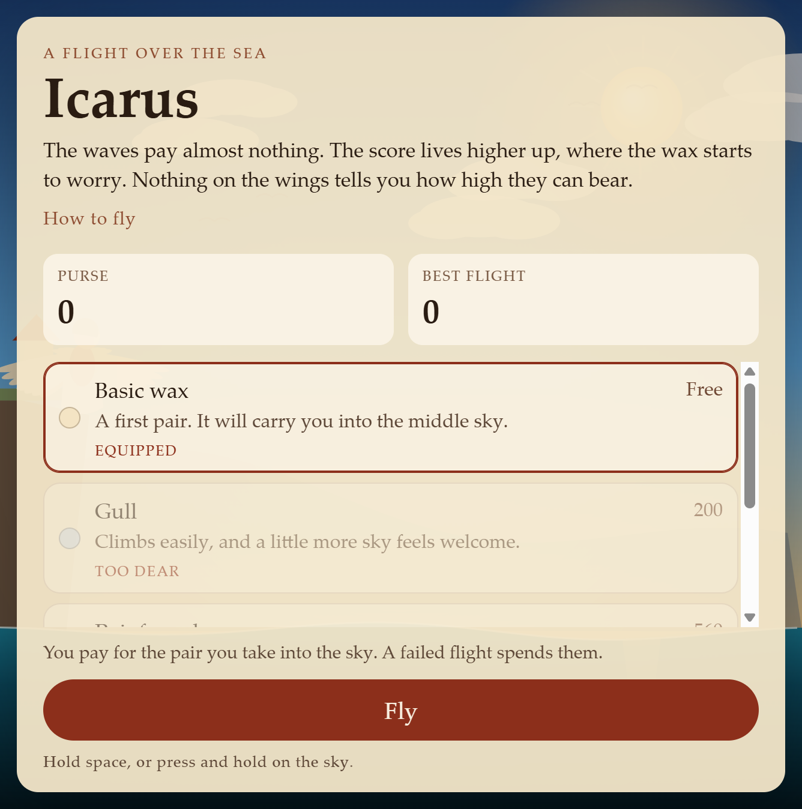
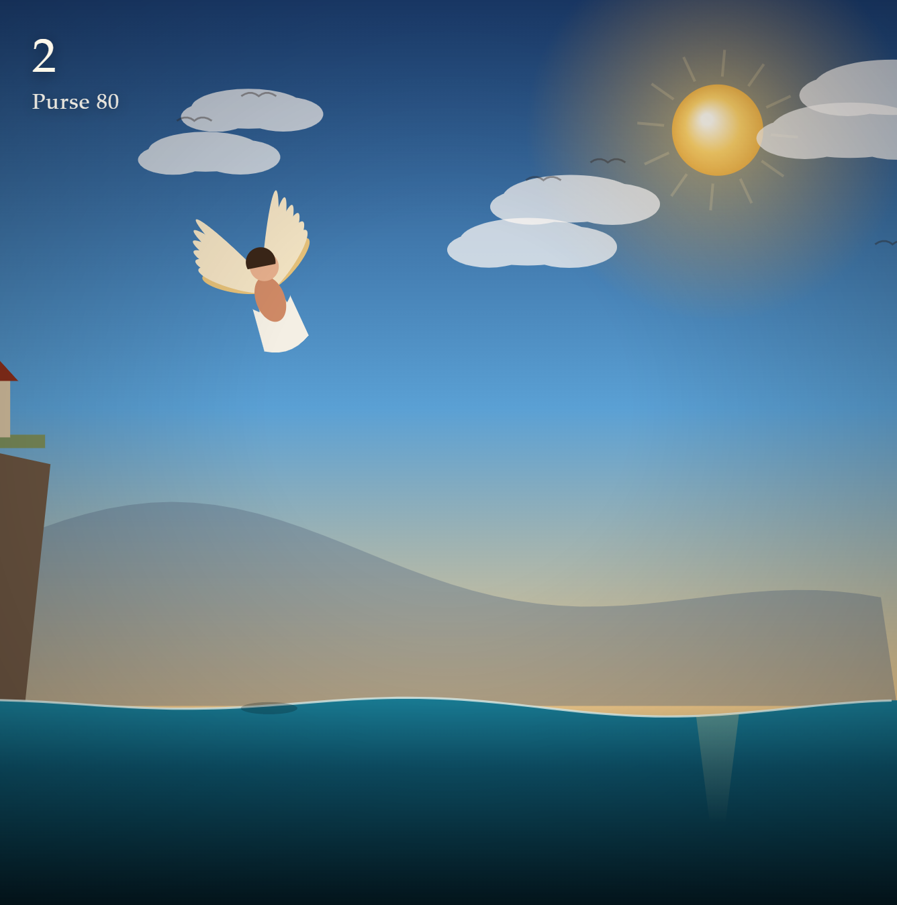

# Icarus

A one-page flight over the sea. Climb as high as the wax will bear. The sun, the birds, and the water are how a flight ends.

**[Play Icarus](https://galactus06.github.io/icarus/)**



## How to fly

Hold Space, or press and hold on the sky. Let go and he falls. The full guide is [How to fly](HOW-TO-FLY.md): the purse, the four pairs of wings, the wax, the gulls, the columns, the night, and the weather.



## Run it locally

The game is plain HTML, CSS, and one canvas script. There is no build step and no install.

```bash
python -m http.server 8766
```

Then open http://127.0.0.1:8766/
